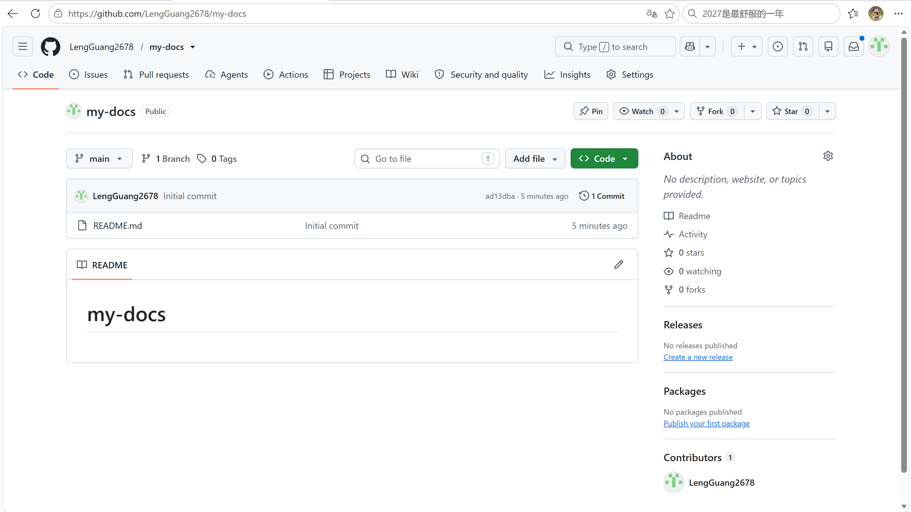
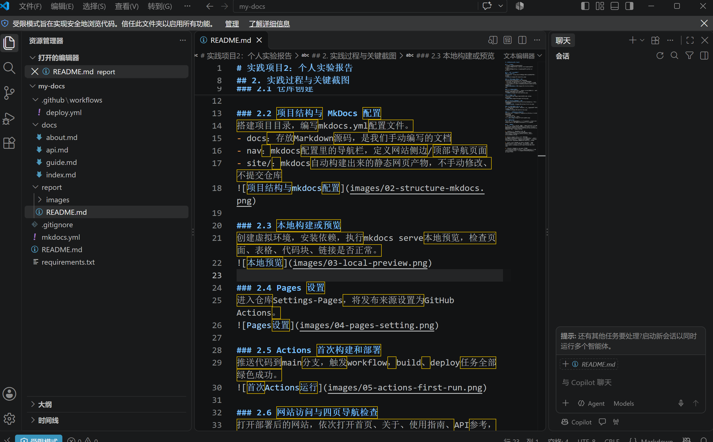
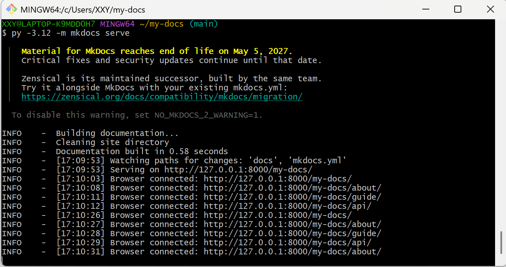
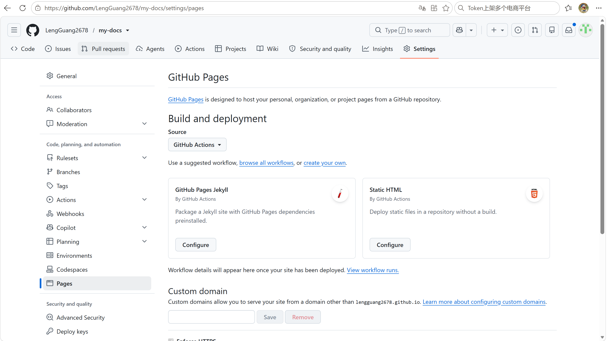
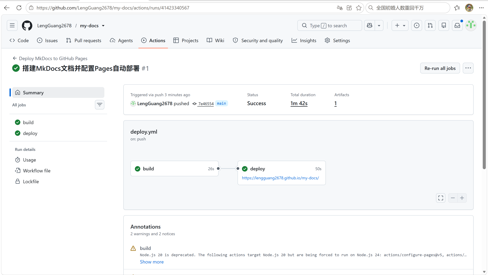
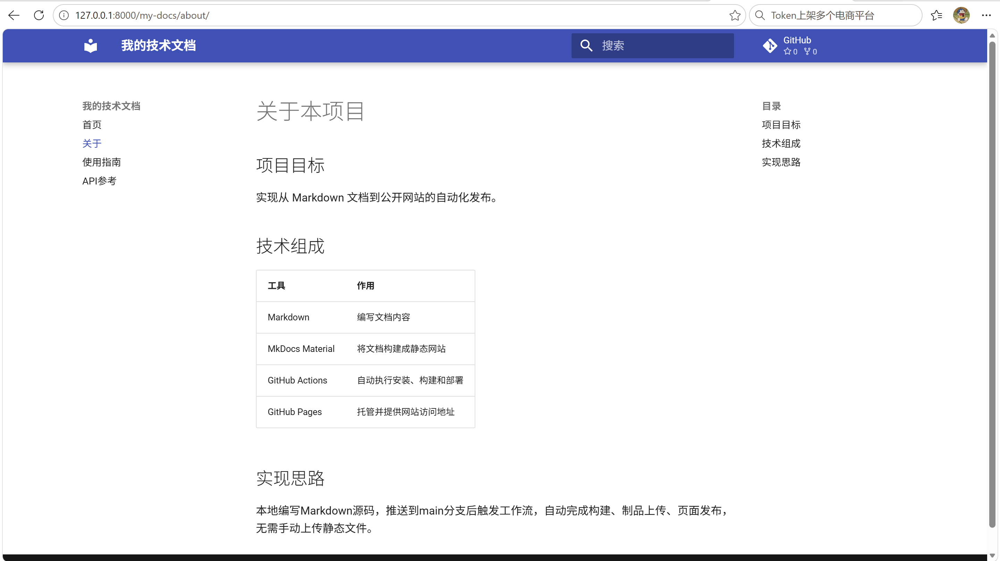
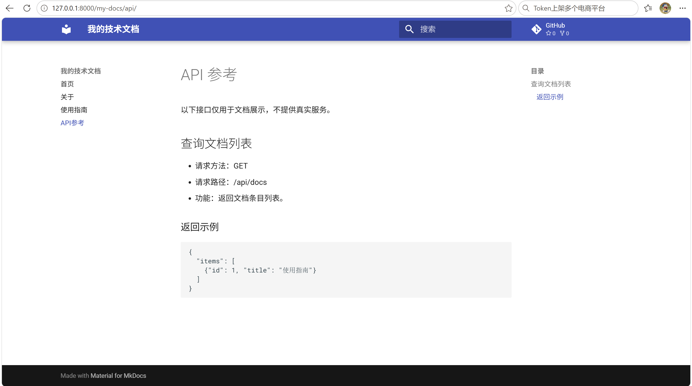
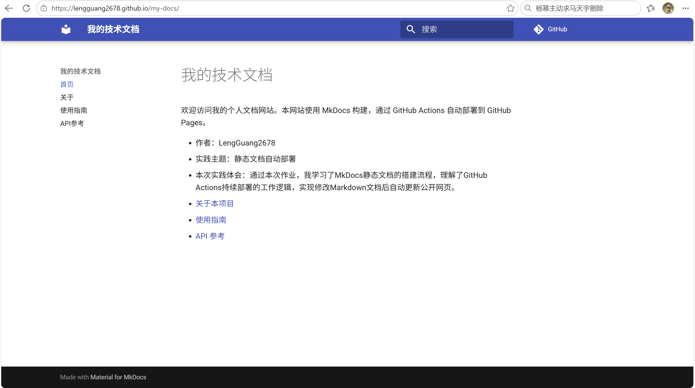
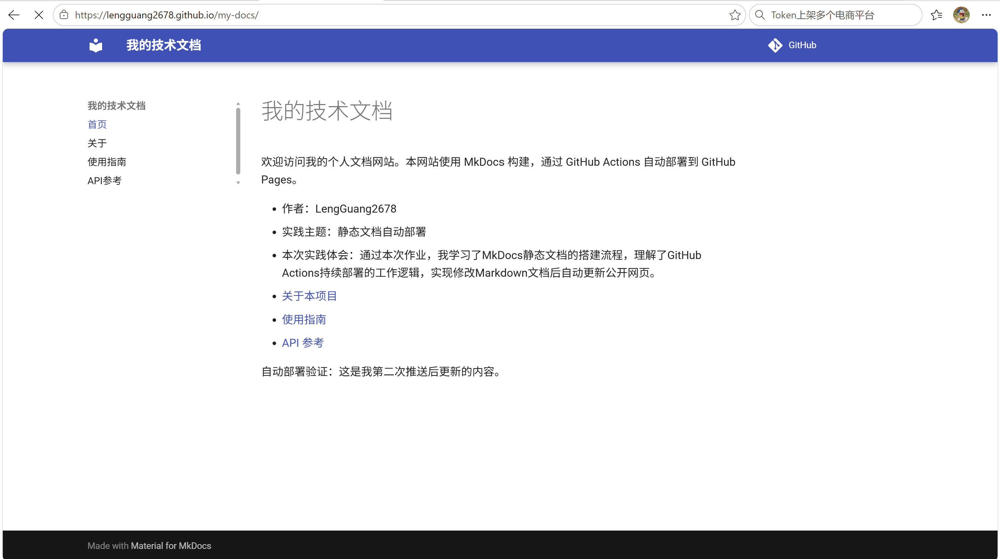

# 实践项目2：个人实验报告

## 1. 基本信息
- GitHub 登录名：LengGuang2678
- 个人仓库地址：https://github.com/LengGuang2678/my-docs
- 最终网站地址：https://LengGuang2678.github.io/my-docs/

## 2. 实践过程与关键截图
### 2.1 仓库创建
本步骤新建公开仓库my-docs，克隆到本地，确认默认分支为main。

### 2.2 项目结构与 MkDocs 配置
搭建项目目录，编写mkdocs.yml配置文件。
- docs：存放Markdown源码，是我们手动编写的文档
- nav：mkdocs配置里的导航栏，定义网站侧边/顶部导航页面
- site/：mkdocs自动构建出来的静态网页产物，不手动修改、不提交仓库

### 2.3 本地构建或预览
创建虚拟环境，安装依赖，执行 `py -3.12 -m mkdocs serve` 启动本地预览服务。
本次检查内容：
1. 四个导航页面（首页、关于、使用指南、API参考）均可正常跳转；
2. about页面的Markdown表格渲染正常；
3. api页面的JSON代码块渲染正常；
4. 页面链接、文字排版无报错，网站预览符合预期。

### 2.4 Pages 设置
进入仓库 Settings → Actions → General，设置 Actions 权限为 Allow all actions and reusable workflows，允许所有Action与可重用工作流；工作流权限设置为读写权限。
随后进入 Settings → Pages，Build and deployment 的 Source 选择 GitHub Actions，使用mkdocs工作流自动部署网页。

### 2.5 Actions 首次构建和部署
推送代码到main分支，触发workflow，build、deploy任务全部绿色成功。

### 2.6 网站访问与四页导航检查
打开部署后的网站，依次打开首页、关于、使用指南、API参考，导航跳转正常。

### 2.7 第二次推送与自动更新验证
修改index.md增加验证文字，再次push，自动触发工作流，网页成功更新。
- 对应提交链接：https://github.com/LengGuang2678/my-docs/commit/8250ba8
- 对应 Actions 运行链接：https://github.com/LengGuang2678/my-docs/actions/runs/41424191221

## 3. 问题与解决
本次实践调试过程中遇到网页更新延迟的现象：提交修改、推送代码，Actions流水线显示build与deploy全部成功，但浏览器访问文档站点仍然展示旧页面。
关键现象：Actions状态Success，但是页面内容没有变化，无报错日志。
原因：GitHub Pages采用CDN缓存机制，普通F5刷新不会清除浏览器与远端CDN缓存，新静态文件分发存在短暂延迟。
解决操作：使用Ctrl+F5强制硬刷新，或者打开浏览器无痕窗口访问网站，等待数分钟后缓存更新，页面成功展示新增的验证文字。
同时提前做了多项配置核对，规避常见错误：
- 核对deploy.yml的YAML缩进规范，全部使用空格缩进，不使用Tab，防止工作流解析语法错误；
- 核对.gitignore配置，排除自动生成的site目录、Python虚拟环境目录，避免编译产物、本地环境文件提交进入版本库，造成仓库冗余；
- 核对工作流触发路径配置，确认只有修改文档、配置文件时才触发部署，修改报告文档不会触发流水线，减少无效部署。

## 4. 原理理解
1. docs/ 和 site/ 各保存什么？为什么不用手工修改 site/？
docs/存放原始 Markdown 源文件，是我们编写、维护的文档源码；site/ 是 mkdocs build自动生成的静态HTML、CSS、JS网页文件。
site目录是编译产物，每次构建都会被覆盖，手动修改里面的内容会在下一次构建时丢失，因此不手工修改。

2. 本次工作流在什么情况下自动运行？
配置中on: push限定：向main分支推送代码，并且改动文件匹配 docs/、mkdocs.yml、requirements.txt、.github/workflows/deploy.yml时自动触发；同时开启workflow_dispatch，支持在Actions页面手动点击运行。

3. build 与 deploy 两个任务有什么区别？
build：构建阶段，拉取源码、配置Python环境、安装依赖、执行mkdocs build，生成静态站点文件，并上传制品；
deploy：部署阶段，依赖build任务成功完成后才执行，将构建好的静态站点发布到GitHub Pages服务。
build负责生成网页，deploy负责上传发布网页。

4. 只修改 report/README.md 会触发部署吗？为什么？
不会触发。工作流的push触发配置里限定了文件路径，report/README.md不在触发监听的文件范围内，修改它不会触发deploy.yml流水线。

5. 本次方案为何无需创建 gh-pages 分支？
传统方案需要把静态文件推送到gh-pages分支；新版GitHub Pages + Actions方案，支持直接把构建产物上传到GitHub Pages内置环境，不需要单独维护gh-pages分支，由GitHub平台托管部署内容。
